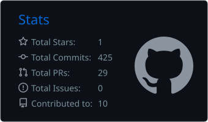
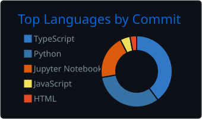
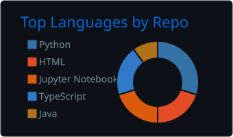
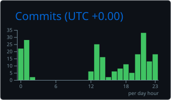

<h1 align="center">Henrique Alves</h1>
<h3 align="center">Full Stack Developer · Node.js · TypeScript · React · PostgreSQL</h3>

  Ciência da Computação @ UFV · Pará de Minas, MG, Brasil

  
  
  

---

### 👨‍💻 Sobre mim

🚀 Criador do **[Lawfy](https://lawfy.app.br)**, SaaS de gestão para escritórios de advocacia, em produção com clientes reais  
🧪 Ex-bolsista de iniciação científica no **UFV Virtual Labs**: desenvolvimento web (React, TypeScript, NestJS) e jogos com Unity  
🛠️ Estagiário de TI no Grupo Agro: suporte a ERP, SQL e automação de processos com n8n  
📄 Artigo de NLP [publicado e apresentado no **WebMedia 2026**](https://sol.sbc.org.br/index.php/webmedia/article/view/46080)  
🎓 Ciência da Computação na UFV, formatura em dezembro de 2026  
📊 Estudando engenharia de dados com um [pipeline próprio](https://github.com/alveshenriique/agro-observatory) (dbt, PostgreSQL, BigQuery)

### 📦 Projetos

| Projeto | Descrição | Stack |
|---|---|---|
| **[Lawfy](https://lawfy.app.br)** | SaaS de gestão para escritórios de advocacia, em produção. Autenticação JWT, permissões granulares, RLS no banco e integração OAuth 2.0 com Google Calendar | Node.js, Express, TypeScript, React, PostgreSQL, Supabase, Railway, Vercel |
| **[agro-observatory](https://github.com/alveshenriique/agro-observatory)** | Pipeline de dados sobre a produção agrícola brasileira: ingestão de APIs públicas, modelagem dimensional e CI | Python, PostgreSQL, dbt, GitHub Actions |
| **[Estudo NLP multiplataforma](https://sol.sbc.org.br/index.php/webmedia/article/view/46080)** | Artigo no WebMedia 2026: análise de cerca de 33 mil comentários de YouTube, TikTok e Instagram, com análise de sentimento em português e modelagem de tópicos | Python, BERTopic, pysentimiento |

### 🛠️ Tecnologias e ferramentas

**Linguagens**

  
  
  
  
  
  
  
  
  

**Backend e frontend**

  
  
  
  

**Bancos de dados e dados**

  
  
  
  
  
  
  
  
  

**Infra, automação e ferramentas**

  
  
  
  
  
  
  
  

**Jogos**

  
  

### 📈 Atividade no GitHub

  
  

  
  

